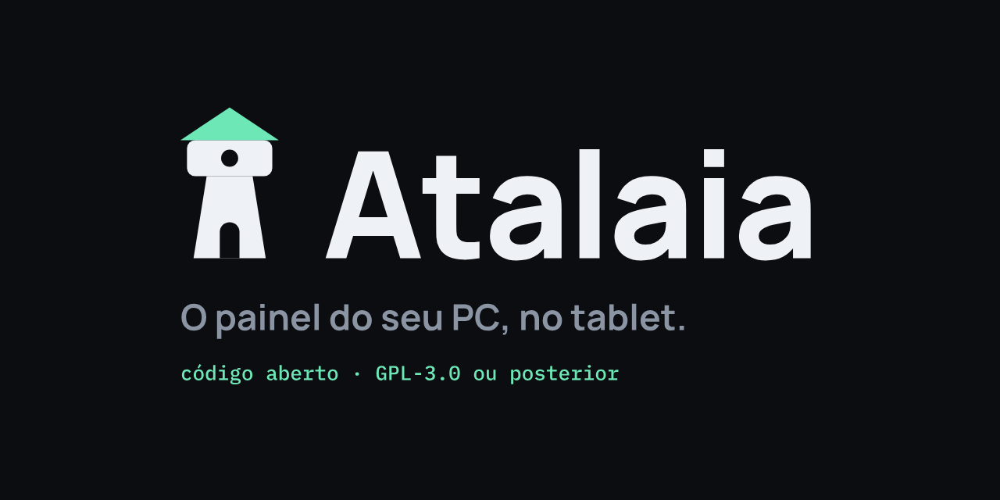

# Atalaia

<p align="center"></p>

Um tablet Android usado vira o painel dedicado do PC: mostra o uso do sistema, a música que está tocando, o Discord e o
uso do Claude, e controla volume, mídia e microfone. Um programa em segundo plano no PC (o **agente**) lê os dados e
executa as ações; o **app do tablet** só desenha as telas e devolve os toques.

**Atalaia** é o posto de vigia de onde se enxerga ao longe: aqui, o tablet que fica de olho no seu PC. O projeto é de código
aberto, sob a [GNU GPL, versão 3 ou posterior](LICENSE) (veja [Licença](#licença)).

> **Versão 0.0.1 (beta).** Em desenvolvimento. O agente está pronto para uso; o app do tablet já conecta, mostra dados ao vivo e
> controla o PC, mas ainda faltam os testes com cabo desplugado e Wi-Fi reais (veja "Estado" mais abaixo).

## Como funciona

```
  PC (Windows 11)                                   Tablet (Android 8.1+)
  ┌──────────────────────┐   WebSocket + HTTP     ┌────────────────────────┐
  │ agente (C#, .NET 10) │ ◄────────────────────► │ app (Kotlin + Compose) │
  │ bandeja do sistema   │  USB (adb reverse) ou  │ coluna "agora" + abas  │
  │ 11 fontes de dados   │  Wi-Fi da rede local   │ troca de USB/Wi-Fi     │
  └──────────────────────┘   protocolo v1         └────────────────────────┘
```

- **Sem nuvem:** só USB (via `adb reverse`) ou a rede local. Nada sai da sua casa.
- **Token:** o agente gera um token na primeira execução; o app precisa dele para conectar. A conexão não usa TLS (é
  loopback ou rede local), e o app só aceita endereços locais.
- **Failover:** o app fala com um endereço por vez, em ordem de prioridade (USB primeiro, depois Wi-Fi), e troca sozinho
  quando um cai. Volta ao preferido assim que ele fica disponível de novo.
- **Contrato:** o protocolo está em [`docs/protocolo-v1.md`](docs/protocolo-v1.md) e manda sobre qualquer outra coisa.

## O que o agente publica

`system` (CPU, RAM, discos, rede), `gpu` (NVIDIA), `media` (faixa, capa e controles), `audio` (volume geral e por
aplicativo), `activeWindow`, `ups` (nobreak Intelbras, com alerta de queda de energia), e as opcionais `weather`,
`notifications`, `claude`, `steam` e `discord`. Só ações declaradas pelos plugins existem: não há comando livre.

> **Compatibilidade do nobreak.** A fonte `ups` funciona hoje **só com nobreaks Intelbras, lendo o banco de dados do software
> deles** (somente leitura). Outras marcas e softwares **ainda não são compatíveis**. Tem outro nobreak? **Pull requests
> adicionando o suporte são muito bem-vindos:** abra antes uma issue contando de onde vêm os dados do seu aparelho e veja
> o [`CONTRIBUTING.md`](CONTRIBUTING.md). O plugin atual (`agent/src/Atalaia.Agent.Plugins.Ups`) serve de modelo.

## Estrutura do repositório

| Pasta | O que é |
|---|---|
| [`agent/`](agent/) | O agente do PC (C#, .NET 10). Plugins por fonte, hub WebSocket, bandeja, simulador. [README](agent/README.md) |
| [`app/`](app/) | O app do tablet. `core/` (Kotlin/JVM: protocolo, conexão, estado) e `tablet/` (Android + Compose). [README](app/README.md) |
| [`docs/`](docs/) | O protocolo v1, a especificação do agente (marco 1) e o [plano do app](docs/plano-app.md) |
| `probe_tests/` | A sondagem antiga, usada como referência de APIs. **Somente leitura.** |

## Começando

Requisitos: Windows 11, SDK .NET 10 (agente); JDK 17 ou mais novo e Android SDK com plataforma 37 e build-tools 36
(app); um tablet Android 8.1 ou mais novo com depuração USB ligada.

**1. Agente.** A partir de `agent/`:

```bash
dotnet run --project src/Atalaia.Agent.Host -- --console --simulate   # dados falsos, sem precisar de hardware
dotnet run --project src/Atalaia.Agent.Host -- --console              # dados reais
```

A cada início o agente gera um **código de 6 dígitos novo**, que aparece no menu do ícone da bandeja e no console. Para o
tablet alcançar o agente pela rede, ligue `Agent:ListenOnLan` (veja o [README do agente](agent/README.md)).

**2. App.** A partir de `app/` (informe o SDK em `ANDROID_HOME` ou em `local.properties`):

```bash
./gradlew :core:test :tablet:assembleDebug
adb install -r tablet/build/outputs/apk/debug/tablet-debug.apk
```

**3. Ligar os dois.** Por USB, o tablet alcança o agente com `adb reverse tcp:8765 tcp:8765`, que o próprio agente mantém
se você ligar `Usb:Enabled` (veja o [README do agente](agent/README.md)); ou faça à mão. Na primeira vez o app abre
a tela de configuração sozinho: informe os endereços do PC em ordem de prioridade (`127.0.0.1` é o USB; o IP do PC é o
Wi-Fi) e o código de 6 dígitos (no PC: menu do ícone da bandeja). Depois, a configuração abre com toque longo no relógio, ou tocando
na faixa de erro de conexão. Para automatizar em build de debug:

```bash
adb shell am start -n org.atalaia.app/.MainActivity --es hosts "127.0.0.1:8765,192.168.0.12" --es token "CODIGO"
```

(`hosts` é a lista de endereços em ordem de prioridade; o token fica guardado cifrado no Keystore do aparelho.)

**Testes.** `dotnet test` em `agent/` e `./gradlew :core:test` em `app/`.

## Estado

| Parte | Situação |
|---|---|
| Agente (marco 1) | Pronto: 11 fontes, ações, capa da mídia, bandeja, simulador |
| App: protocolo, conexão, failover USB/Wi-Fi, estado | Pronto e testado (a troca de canal foi testada só com rede falsa) |
| App: telas Início, Sistema, Mídia, Discord, Jogo (Steam) e Claude | Prontas, conferidas no tablet real com o agente simulado |
| App: tela de configuração (endereços e token) | Pronta, conferida no tablet real |
| Agente: módulo que mantém o `adb reverse` sozinho (`Usb:Enabled`) | Pronto, conferido com o tablet real |
| Teste com cabo e Wi-Fi reais, medição final de desempenho | A fazer |

O acompanhamento detalhado, com decisões e resultados de medição, está em [`docs/plano-app.md`](docs/plano-app.md).

## Ramos, versões e releases

O projeto usa três tipos de ramo. A diferença que importa para quem usa e para quem contribui:

| Ramo | Para que serve | Tag | Release no GitHub | Quem deve usar |
|---|---|---|---|---|
| **`main`** | Só o que é **estável**. É a versão que todo mundo deve instalar | `vX.Y.Z` | normal (a "latest") | usuários em geral |
| **`development`** | Integração e **beta**: o que já passou do ciclo de trabalho e está sendo testado antes de virar estável | `vX.Y.Z-beta.N` | pré-lançamento | quem escolheu o canal **Beta** e aceita bugs |
| **`beta/X.Y.Z`** e sub-ramos (`feat/`, `fix/`, `docs/`, `chore/`) | **Trabalho** de uma versão em andamento | sem tag | nenhuma | quem desenvolve |

Em uma frase: tag de versão em `main` é estável; tag de beta em `development` é beta; o trabalho de cada versão acontece em
`beta/X.Y.Z` e só entra em `development` quando está pronto.

```
feat/x ─┐
fix/y  ─┴─> beta/0.1.2 ──PR──> development ──PR──> main
 (squash)               (merge commit)       (merge commit)
                              │ v0.1.2-beta.N         │ v0.1.2
                              └─ release beta         └─ release estável
```

- **Nada de commit direto** em `main` nem em `development`: tudo entra por pull request com o CI verde (`agente`, `app` e `scripts`).
- **Quer contribuir?** Abra o PR para o ramo do ciclo (`beta/X.Y.Z`, o mais recente), nunca para `main` nem `development`. Quem
  integra o ciclo e cria as tags é o mantenedor.
- **Atualização automática:** o agente tem dois canais. **Estável** só considera releases normais (`main`); **Beta** considera também os
  pré-lançamentos (`development`). Ele nunca faz downgrade.
- **Número da versão (SemVer):** `MAJOR.MINOR.PATCH`. Correção compatível sobe o PATCH, recurso novo sobe o MINOR, quebra sobe o MAJOR. Antes da
  `1.0.0` um MINOR pode quebrar compatibilidade, e as notas avisam. O número do ciclo fica no arquivo [`VERSION`](VERSION).
- **O que cada release publica:** o instalador do agente (`Atalaia-Agent-Setup-<versão>.exe`), o APK do tablet
  (`Atalaia-Tablet-<versão>.apk`), o `SHA256SUMS.txt` e as notas.

Todas as regras (merge, hotfix, tags, assinatura) estão em [`docs/versionamento-e-releases.md`](docs/versionamento-e-releases.md). O que
vem em cada versão está no [`ROADMAP.md`](ROADMAP.md).

## Tablet alvo

Medido no tablet T68 (MediaTek MT6737T, 32 bits, Android 8.1, cerca de 1,4 GB de RAM reais, tela de 862 × 505 dp em
paisagem). O app foi desenhado para esse limite: sem animação contínua, tela atualizada a 2 Hz, capas reduzidas e
cache pequeno. A medição no tablet real mostrou uso de memória e de CPU baixos.

## Licença

Copyright (C) 2026 Pedro Serôdio. O Atalaia é software livre: você pode redistribuí-lo e/ou modificá-lo sob os termos da GNU
General Public License, na versão 3 da Licença ou (a seu critério) qualquer versão posterior. Ele é distribuído na esperança de ser
útil, mas **sem nenhuma garantia**. O texto completo está em [`LICENSE`](LICENSE) e o aviso padrão em [`NOTICE`](NOTICE).
Cada arquivo de código traz o identificador `SPDX-License-Identifier: GPL-3.0-or-later`.
A logo e o ícone (`assets/brand/`) são do projeto e seguem a mesma licença; os textos da logo são contornos das fontes
Manrope e IBM Plex Mono (SIL OFL 1.1).

As bibliotecas e fontes de terceiros, com as suas licenças, estão em [`THIRD-PARTY-NOTICES.md`](THIRD-PARTY-NOTICES.md).
Contribuições enviadas ao projeto passam a valer sob essa mesma licença.
